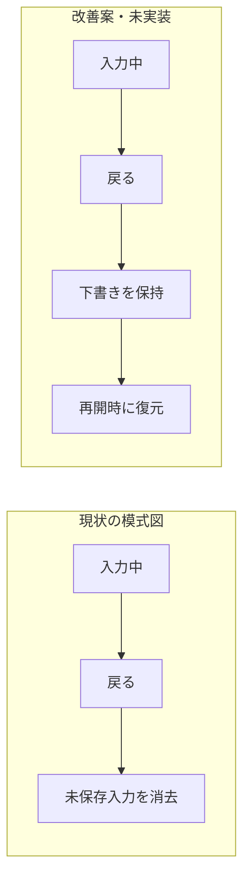

# ユーザーへの提示方法の改善 — 2026-10-11

ユーザーから「絵や図が少なすぎる。表や箇条書きで簡潔にまとめるべき」と指摘を受けた。評価の根拠を残すことと、チャットへ長文を並べることを分ける。

| 改善 | 対象 | 守る境界 |
| --- | --- | --- |
| 結論、図、比較表を先に提示 | dif-design / dif-evaluate / dif-improve | 短縮しても不確実性を消さない |
| 問題箇所や改善前後をインラインで示す | 同上 | 実画面・模式図・提案を区別し、未観測の実画面を捏造しない |
| 詳細な根拠は別資料へ分ける | 同上 | 証拠の分類と参照を保持する |
| 描画できなければテキスト図へ代替 | 同上 | ツールなしでも利用可能、未生成を明示する |

ユーザー向け要約の例（架空の入力画面。実製品の観測ではない）：

**入力保護を優先。** 現在の画面構成を保ち、戻るときの扱いを変える案。

| 優先 | 問題 | 改善案 | 未確認 |
| --- | --- | --- | --- |
| 高 | 戻ると入力を失う | 下書きを保持 | 実装・端末動作・利用者評価 |

- 詳しい原因・根拠・他案は詳細資料に置く。
- この例は提示方法の見本。改善効果の実証ではない。

検証：Skillメタデータ・参照・同梱リソースの整合を機械確認する。これは提示品質の行動評価ではない。図の分かりやすさ、説明量、判断しやすさは次回試用で人間のフィードバックを得るまで未確認。QIFの採用・Stable判定は変更しない。スキーマ、CLI、成果物契約、アーキテクチャは変更していない。
