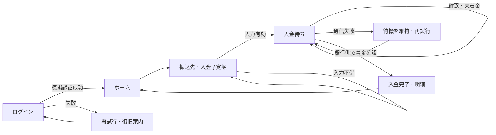
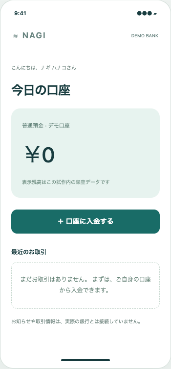
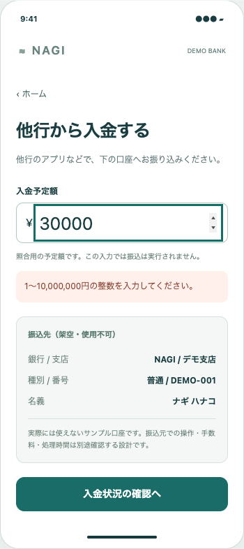
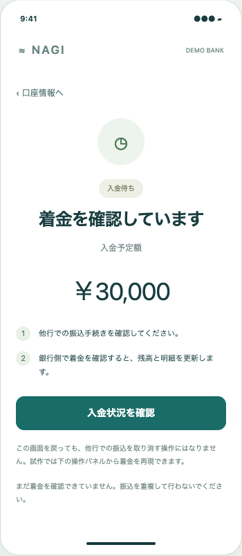
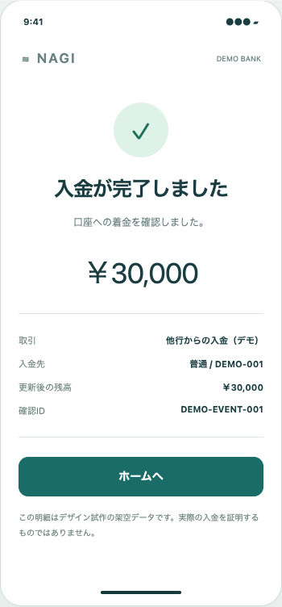

# NAGI — ログインから入金完了まで

**推奨案A：口座情報を案内し、銀行側で確認された着金だけを完了にする。** 口座開設・本人確認済み、他行の本人名義口座から振り込む設定。金額や名義は架空。ATM現金入金、口座開設、実認証、銀行API接続は範囲外。

|  | 案A：標準の他行振込案内（試作済み） | 案B：連携による入金支援（構想のみ） |
| --- | --- | --- |
| 体験 | ログイン→口座→振込先確認→他行で操作→着金待ち→完了 | ログイン→対応する他行を選択→同意・認証→振込手続き→着金確認 |
| 強み | 外部連携が未定でも情報と状態を明確にできる | 転記やアプリ切替を減らせる可能性 |
| 代償 | 別アプリでの操作・転記負担が残る | 対応銀行、同意・認可、取消、障害、再試行、法務/セキュリティの個別検討が必要 |
| 判断 | 新規サービスの初期案として推奨。人間の採用はpending | 接続先と実装・運用条件が確認できるまで候補。実現可能と判定しない |

## 画面と遷移

説明用フロー。ソフトウェアの責務と採否の正本はstudies.archmodel.yaml、architecture.svgはその生成投影。

| ホーム | 振込先確認 | 入金待ち | 完了 |
| --- | --- | --- | --- |
|  |  |  |  |

入金予定額は照合用の試作入力で、実際の振込指示ではない。最初の残高は0円。模擬着金で30,000円、明細とホームの残高を一致させる。同じDEMO-EVENT-001は二重計上しない。ページ再読込は試作をリセットするため、実システムの永続性・正確な台帳処理を証明しない。

## 失敗時の設計

| 状態 | UIと保護 | 実装の境界 |
| --- | --- | --- |
| 認証失敗 | ログインに留まり、再試行と復旧導線を提示 | OSパスキーは呼ばない。復旧は説明のみ |
| 無効な予定額 | 入力を保持、エラー先へfocus、先に進まない | 1〜10,000,000円は試作の仮仕様、銀行の上限ではない |
| 未着金 | 待機を維持。再確認で残高を増やさない | 自己申告・ボタン押下は銀行の記録の代わりにならない |
| 確認通信失敗 | 未着金とも完了とも断定せず、状況未確認として再試行 | 設計上は最後に確認した状態と更新日時も扱う必要がある |
| 重複イベント | 一回だけ反映 | メモリ内デモ。サーバー台帳・複数端末・再起動の整合性は未実装 |
| 戻る | 予定額を保持し口座情報へ戻る | 他行の振込の取消を意味しない |

製品化前の未解決事項：実認証とセッション期限、振込元/入金元の照合、予定額と着金額の差額・分割入金、着金後の訂正、処理時間と手数料の実データ、通知許可・秘匿、復旧の本人確認、実APIの冪等性と監査、支援技術・端末での評価。ここで銀行業務・法令適合を保証しない。
