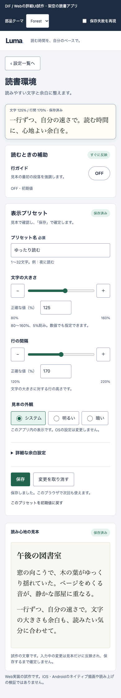

# 共通部品とカスタマイズ

この試作では、文字サイズと行間を同じ `numeric-control.js` から生成する。CSSは `styles.css` に集約。画面上部の「部品テーマ」でLuma/Forestを切り替えられる。製品向けライブラリ全体の実装ではなく、変更の伝播を確かめる小さな実例。

| 共通部分 | 契約と責務 | カスタマイズ |
| --- | --- | --- |
| 数値調整部品 | 一意のID、ラベル、min/max/step/value、説明。range、±、精密入力、エラー先を生成 | この例は%専用。他単位対応は契約変更として扱う |
| 特徴固有の状態 | preview.jsがraw draft・有効な見本・保存値、入力検証と保存を所有 | 共通部品にlocalStorageや製品固有の上限判断を埋め込まない |
| 意味別の配色 | accent/on-accent/focus/selectedと明暗の対応 | brandはこれらを上書き。errorの意味や文字拡大は維持 |
| 形状 | control-radius / surface-radius | 共通値で両方の数値部品やカードへ伝播 |

数値部品のDOM IDとdata-stepはpreview.jsとの内部契約である。再利用可能な公開APIとして版管理済みではない。変更時は両利用箇所・ラベル参照・イベント・フォーカス・保存経路を確認する。未使用のslotやvariantを先回りして増やさない。

Forestは配色/形状の変更例。利用者の読書外観設定とは独立し、ブランド切替は保存設定に混ぜない。既存の入力を破棄しない。密度や操作対象サイズはブランドの上書き対象にしていない。

変更例：共通control-radiusを変えると文字サイズ/行間の両精密入力へ反映する。空欄編集中にテーマを変えても空欄を保持し、保存時にエラー、修正後に保存できることをcomponent-check.mjsで確認する。

保守：この例の所有範囲はsettings-detail。破壊的変更では利用箇所、変更理由、移行方法、以前の版への戻し方を残す。別製品への配布、長期移行、native部品や全テーマのアクセシビリティは未検証。実際の保守工数改善は測定していない。
