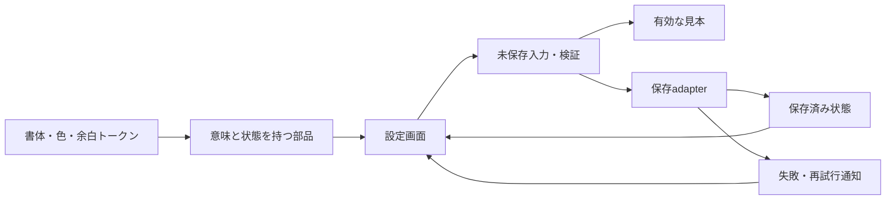

# Luma設定試作 — 書体と実装構成の判断例

対象はこのリポジトリの架空Web試作。実プロダクトの移行提案ではない。2026-10-11にpreview.html / preview.jsを読み、既存の描画・動作記録と区別して整理した。候補を独立に比較実装した評価ではない。

| 判断 | 現状・推奨 | 代替とトレードオフ | 根拠／残件 |
| --- | --- | --- | --- |
| 操作文の書体 | OSのシステム書体と日本語fallbackを維持 | 配布Webフォントは字形を揃えやすいが、配信・権利・読込時の再配置が増える | CSSを確認。実際の字形・ウェイトはOS依存、全OS比較は未実施 |
| 読書見本 | serif系で操作面と役割を分け、remで文字拡大 | 本番で文学的な印象を固定するなら具体的な和文書体の実サイズ比較が必要 | generic serifなので同じ字形の保証なし。銘柄採用は保留 |
| 小さな補助文 | hierarchy上は弱めるが、製品化前に可読性を再評価 | 10〜12px相当の補助文を大きくすれば縦長になるが読みやすさを優先できる | 200%ルート文字で確認済みでも、通常サイズの実ユーザー可読性は未測定 |
| ロゴの太さ | font-weight:750は試作上の指定 | 可変書体の対応軸を確認するか、実在ウェイトを選ぶ | 750の字形が使われたという証拠はない |
| プラグイン | この単画面には追加しない | 数値/フォームライブラリは多画面化や共通規則が増えた段階で比較 | HTML range・number・dialogで現在の経路は動く。IME/支援技術は残件 |
| フレームワーク | 現在のHTML/CSS/JSで試作を維持 | 製品の既存フレームワークに組み込む際は標準部品/状態管理へ適合 | 新規SPAへの書換えで改善する根拠がない。HTMLをnative検証と同一視しない |
| 状態 | raw draft・last valid preview・savedを区別 | 生の値を単一numberへまとめると空欄を失う。すべてグローバル化すると所有者が曖昧 | 現コードとエラー/保存経路を確認。複数画面・並行保存は未実装 |
| 永続化 | localStorage境界の試作 | 本番は保存adapterを分離し、認証・競合・再試行を実要件から決める | 現在はサーバーなし。下図の分離は提案であり実装済みではない |

## 実装と提案の境界

現在：preview.htmlが表示とCSS、preview.jsが入力・検証・描画・保存を一つのファイル内で担当。保存失敗の切替は検証用。以下は製品に組み込む場合の責務分割案であり、現在のモジュール構成を描いたものではない。

試作のための説明図で、ArchModelの代替となる独立した設計ソースではない。対象プロダクトでこの案を採用する場合は、そのArchModelへ責務・契約・代替案を記録しArchMapを生成する。DIF本体のArchModelには「このような技術判断を提案する責務」を記録する。

製品向けの次の確認は、実際のOS/ブラウザで同一文面の書体見本、フォールバック、実キーボード/IME、支援技術、実保存境界。新しい依存やフォントはこの記録で導入していない。
