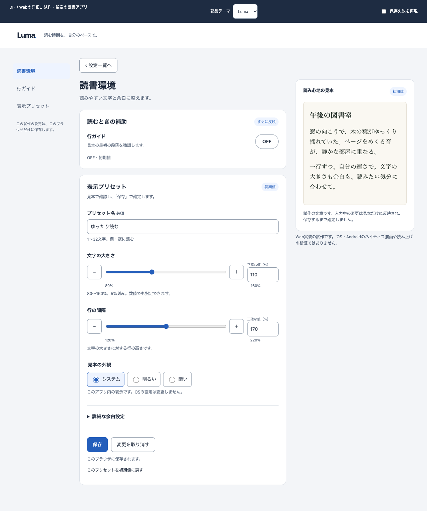
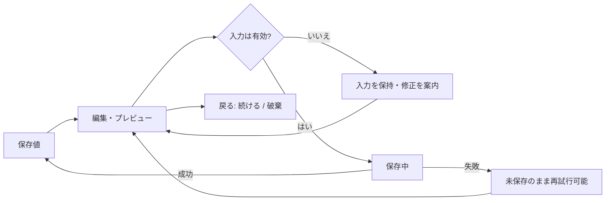
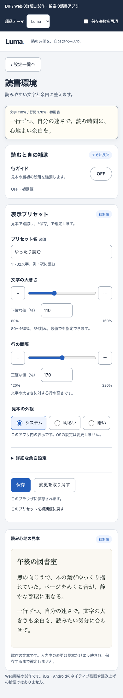
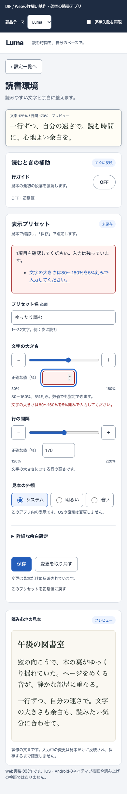
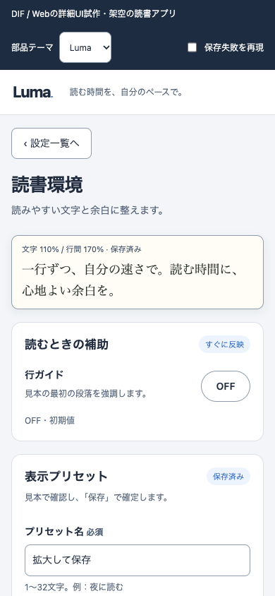
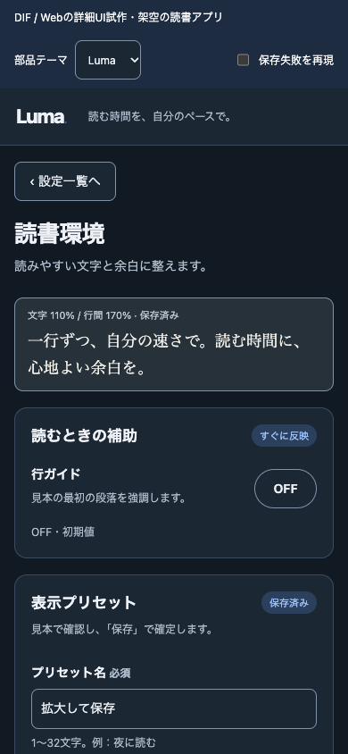
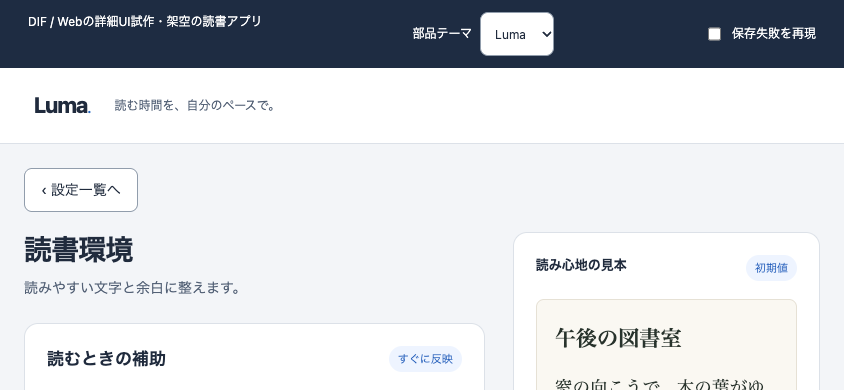

# Luma — 詳細な設定画面の提案

架空の読書アプリ。**即時設定と、見本を確認して保存する設定を分ける。** ラベル、単位、現在値、失敗時の回復を画面に組み込んだWeb試作。

[操作する](preview.html) · [ローカル検証結果](checks.json) · [公式ガイドラインと適用範囲](../../skills/dif-controls/references/sources.md)

## 画面構成と操作の選択

| 要素 | 構成・採用理由 | 反映と保存 |
| --- | --- | --- |
| 行ガイド | 独立した二値設定なのでswitch。ONの意味を隣接説明 | 即時反映・localStorage保存。失敗時は元の状態を保持 |
| プリセット名 | 常時ラベルのあるテキスト入力。必須と上限を表示 | 未保存入力として保持。保存時検証 |
| 文字サイズ・行間 | range + 数値入力 + ±。大まかな調整と精密入力を併用 | 有効値のみ見本に反映。空欄・範囲外・刻み違反を黙って補正しない |
| 見本の外観 | 三つから一つなのでradio。システム設定を変更するものではない | プレビュー後、明示保存 |
| 詳細な余白 | 補助的な設定としてdisclosure内。単一選択select | プレビュー後、明示保存 |
| 保存・取消 | 詳細設定の外に常時配置 | 失敗時も入力保持。取消は最後の保存値へ戻す |
| 初期化・Undo | プリセットだけを初期値へ。一回のUndo | 初期化も保存までは見本のみ。行ガイドは対象外 |

範囲は文字80〜160%・行間120〜220%、いずれも5%刻みという架空製品の仕様。一般的なOS既定値ではない。保存はこのブラウザのみ、サーバー通信なし。通知許可などの本物のOS操作は行わない。

## 狭幅とエラー

| 通常 | 入力エラー |
| --- | --- |
|  |  |

狭幅では精密入力をスライダーの下に分け、操作対象を圧縮しない。小さな文字見本を近くに残し、完全な見本は下にも表示。画面高が小さい場合は固定を解除する。200%ルート文字サイズで折り返しと保存操作を確認。キーボード実表示やOSの文字拡大での重なりは実機の残課題。

## Web / iOS / Androidへの受け渡し

| 項目 | Web試作 | iOS/iPadOS案（未実装） | Android案（未実装） |
| --- | --- | --- | --- |
| 構成 | 広幅でナビ・フォーム・見本、狭幅で縦積み | 設定グループと詳細画面、標準の戻る。iPadは幅に応じた詳細表示 | カテゴリと関連する詳細画面、システムBackで復帰 |
| 操作部品 | HTML input/fieldset/label、range、dialog | 対象OSの標準toggle/slider/fieldを起点にする | 対象ライブラリのMaterial部品と意味情報を起点にする |
| 保存 | 即時と明示保存を別セクション化 | 同じ損失境界を保ち、閉じるジェスチャーでも未保存入力を保護 | 同じ損失境界を保ち、Back/プロセス再生成時の状態を設計 |
| 検証 | Chromiumで幅・入力・失敗・回復を確認 | Dynamic Type、VoiceOver、キーボード、iPadで別途確認 | フォント拡大、TalkBack、IME、Backで別途確認 |

この表は設計上の対応案で、HTMLをネイティブUIと見なしてはいない。iOSのpt、Androidのdp、WebのCSS pxを混同しない。具体的な数値や例外は同梱の公式参照資料で確認する。

## 実際に確かめた範囲

- 1280/390/320pxで横はみ出し、rangeの矢印/End操作、数値入力との同期、単一ポインタの±を確認。
- 空欄・範囲外・刻み違いを保持し、保存を止めてエラー先へフォーカスする経路を確認。
- 保存失敗→入力保持→再試行→リロードで保存値復元を確認。即時switchの失敗も以前の値を維持。
- 初期化→Undo、取消、未保存で戻る→継続/破棄を確認。
- PC通常画面と390pxの通常・エラー画像を作者が目視。狭幅で見本が遠い問題を認識して小さなプレビューを追加。

残件：Safari/Firefox、実機キーボード・IME、スクリーンリーダー、実ブラウザの文字拡大・ズーム、永続下書き復旧、サーバー競合は未検証。ブラウザ離脱はbeforeunloadで補助するだけで、強制終了やすべての環境での保護を保証しない。意味情報を付けたことをアクセシビリティ適合と同一視しない。採用はpending。

再実行：`node examples/settings-detail/check.mjs <installed-playwright-directory> <chromium-executable>`。任意のローカル検証補助であり、Skillの依存ではない。

## 画面条件・配色・質感・動き

[適応UIの実測記録](adaptive-checks.json) · [設計と評価のガイド](../../skills/dif-ux-ui/references/adaptive-finish.md)

| 条件 | この試作の対応 | 確認の限界 |
| --- | --- | --- |
| 幅・高さ | 1000px以下でナビを外し、680px以下で縦積み。高さ560px以下では小見本の固定を解除 | 境界前後、320px〜2560pxの指定窓で確認。すべての中間値の保証ではない |
| 縦横切替 | 空欄を含む入力、フォーカス、開いた確認dialogを保持 | 390×844 ↔ 844×390のWebリサイズ。実機の回転・アプリ再生成は未検証 |
| 密度 | DPR 1/2/3でも同じ論理幅で同じフォーム幅。画像の物理幅はDPRに追従 | 実ディスプレイの鮮明さ・色域の評価ではない |
| 文字拡大 | rem単位でラベル・本文・読み見本を拡大。ラベルとボタンを折り返す | 200%ルートフォントの負荷確認。400%ブラウザズームやDynamic Typeとは別 |
| 明暗 | OS設定に応じた操作画面。読書見本だけは利用者が上書き可能 | 不透明な本文・補助文・保存ボタン・見本文字の組だけコントラスト計算 |
| 動き軽減 | ボタンの押下移動と遷移を止め、操作・保存通知は維持 | フレーム性能・実機の触覚・支援技術は未検証 |

| 明るい画面 | 暗い画面 |
| --- | --- |
|  |  |

質感の方針は「静かな操作面と、少し暖かい読書面」。不透明なカードと細い境界でまとまりを作り、影は浮いている小見本に限定。角丸はカード14px、操作部品7〜8px、switchはカプセル形として役割を分けた。暗い画面は背景・表面・境界・文字を別の色にし、紙色を単純反転しない。これらは架空の読書アプリ向けの設計判断で、OS共通の推奨値ではない。

動きの仕様：ボタン押下時にY方向へ0→1px、背景・境界とともに120ms ease-out。解放時は逆方向へ、連打時はCSS遷移の現在位置から追従。動き軽減時は移動なし・即時変化。保存処理はアニメーション完了に依存しない。目的は操作を受け付けた手掛かりであり、装飾のための常時アニメーションは置かない。保存中の状態表示は文字でも伝える。

再実行：`node examples/settings-detail/adaptive-check.mjs <installed-playwright-directory> <chromium-executable>`。高コントラスト用CSSも用意したが、forced-colorsの視認性・操作は未検証。残課題を通過扱いにしない。

[フォント・依存・フレームワーク・責務分割の判断例](implementation-fit.md)：現状と製品化時の提案、未検証事項を区別しています。

[共通部品とカスタマイズ](components.md)：文字サイズ/行間を共通ソースにし、テーマ変更と入力保持を実装。
