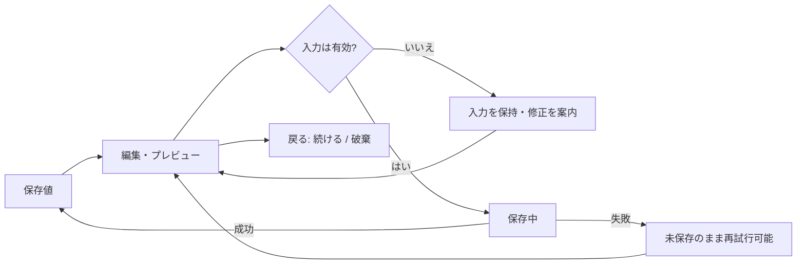

# Luma — 詳細な設定画面の提案

架空の読書アプリ。**即時設定と、見本を確認して保存する設定を分ける。** ラベル、単位、現在値、失敗時の回復を画面に組み込んだWeb試作。

[操作する](preview.html) · [ローカル検証結果](checks.json) · [公式ガイドラインと適用範囲](../../skills/dif-controls/references/sources.md)

## 画面構成と操作の選択

| 要素 | 構成・採用理由 | 反映と保存 |
| --- | --- | --- |
| 行ガイド | 独立した二値設定なのでswitch。ONの意味を隣接説明 | 即時反映・localStorage保存。失敗時は元の状態を保持 |
| プリセット名 | 常時ラベルのあるテキスト入力。必須と上限を表示 | 未保存入力として保持。保存時検証 |
| 文字サイズ・行間 | range + 数値入力 + ±。大まかな調整と精密入力を併用 | 有効値のみ見本に反映。空欄・範囲外・刻み違反を黙って補正しない |
| 見本の外観 | 三つから一つなのでradio。システム設定を変更するものではない | プレビュー後、明示保存 |
| 詳細な余白 | 補助的な設定としてdisclosure内。単一選択select | プレビュー後、明示保存 |
| 保存・取消 | 詳細設定の外に常時配置 | 失敗時も入力保持。取消は最後の保存値へ戻す |
| 初期化・Undo | プリセットだけを初期値へ。一回のUndo | 初期化も保存までは見本のみ。行ガイドは対象外 |

範囲は文字80〜160%・行間120〜220%、いずれも5%刻みという架空製品の仕様。一般的なOS既定値ではない。保存はこのブラウザのみ、サーバー通信なし。通知許可などの本物のOS操作は行わない。

## 狭幅とエラー

| 通常 | 入力エラー |
| --- | --- |
|  |  |

狭幅では精密入力をスライダーの下に分け、操作対象を圧縮しない。小さな文字見本を近くに残し、完全な見本は下にも表示。画面高が小さい場合は固定を解除する。キーボード実表示や拡大文字での重なりは実機の残課題。

## Web / iOS / Androidへの受け渡し

| 項目 | Web試作 | iOS/iPadOS案（未実装） | Android案（未実装） |
| --- | --- | --- | --- |
| 構成 | 広幅でナビ・フォーム・見本、狭幅で縦積み | 設定グループと詳細画面、標準の戻る。iPadは幅に応じた詳細表示 | カテゴリと関連する詳細画面、システムBackで復帰 |
| 操作部品 | HTML input/fieldset/label、range、dialog | 対象OSの標準toggle/slider/fieldを起点にする | 対象ライブラリのMaterial部品と意味情報を起点にする |
| 保存 | 即時と明示保存を別セクション化 | 同じ損失境界を保ち、閉じるジェスチャーでも未保存入力を保護 | 同じ損失境界を保ち、Back/プロセス再生成時の状態を設計 |
| 検証 | Chromiumで幅・入力・失敗・回復を確認 | Dynamic Type、VoiceOver、キーボード、iPadで別途確認 | フォント拡大、TalkBack、IME、Backで別途確認 |

この表は設計上の対応案で、HTMLをネイティブUIと見なしてはいない。iOSのpt、Androidのdp、WebのCSS pxを混同しない。具体的な数値や例外は同梱の公式参照資料で確認する。

## 実際に確かめた範囲

- 1280/390/320pxで横はみ出し、rangeの矢印/End操作、数値入力との同期、単一ポインタの±を確認。
- 空欄・範囲外・刻み違いを保持し、保存を止めてエラー先へフォーカスする経路を確認。
- 保存失敗→入力保持→再試行→リロードで保存値復元を確認。即時switchの失敗も以前の値を維持。
- 初期化→Undo、取消、未保存で戻る→継続/破棄を確認。
- PC通常画面と390pxの通常・エラー画像を作者が目視。狭幅で見本が遠い問題を認識して小さなプレビューを追加。

残件：Safari/Firefox、実機キーボード・IME、スクリーンリーダー、200%文字拡大、永続下書き復旧、サーバー競合は未検証。ブラウザ離脱はbeforeunloadで補助するだけで、強制終了やすべての環境での保護を保証しない。意味情報を付けたことをアクセシビリティ適合と同一視しない。採用はpending。

再実行：`node examples/settings-detail/check.mjs <installed-playwright-directory> <chromium-executable>`。任意のローカル検証補助であり、Skillの依存ではない。
