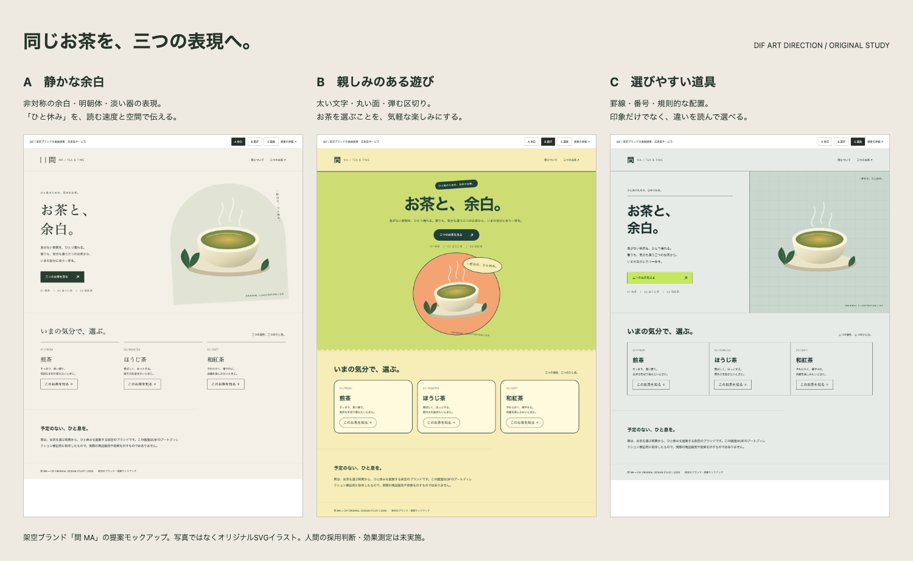
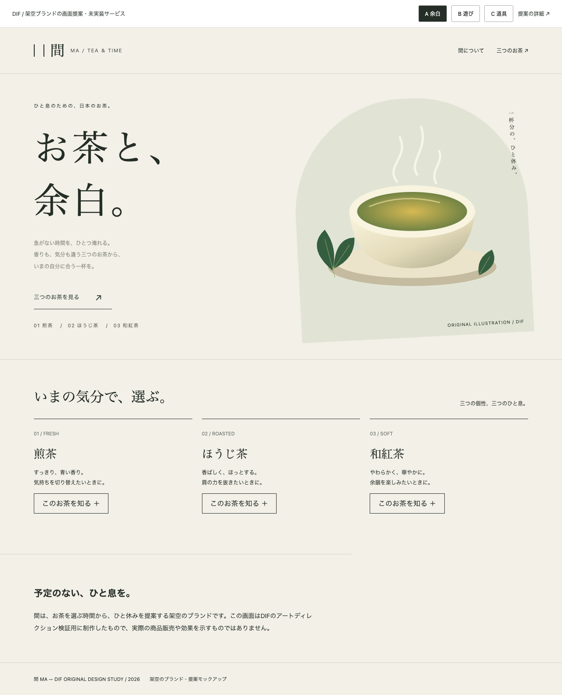
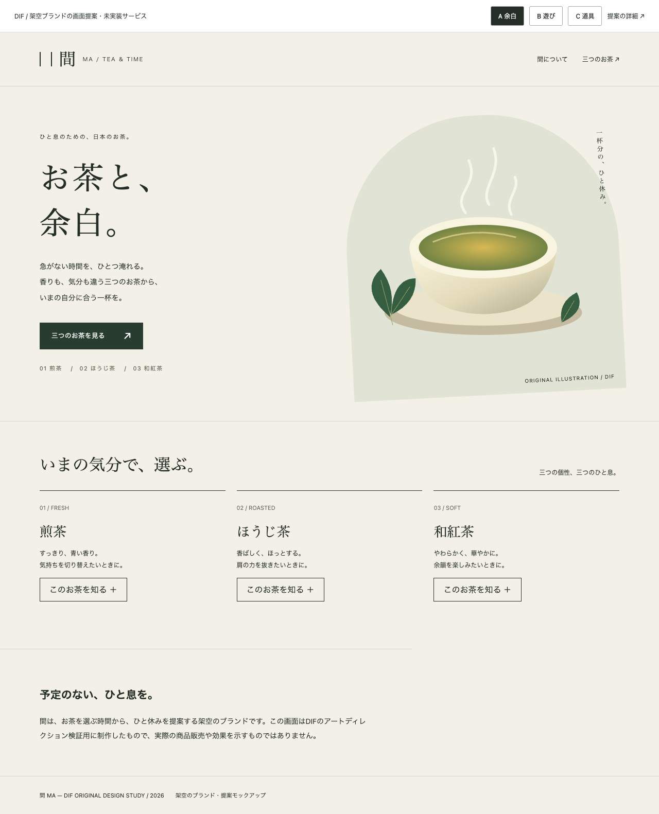

# 間 MA — ブランドの意味から画面へ

**提案：A「静かな余白」を第一候補にする。** 架空ブランドの約束「ひと息」を、空間と読む速度で表現する。親しみや選びやすさを重視する場合はB・Cも比較対象になる。作者による推奨で、採用はpending。

[操作できる画面案](preview.html) · [比較ボード](board.html)

## 同じ条件で比較

対象は忙しい成人が一杯のお茶を選ぶ場面。名前「間 MA」、見出し「お茶と、余白。」、三つの茶葉、主要操作を揃え、PC幅1280・狭幅390で制作した。商品・効果・産地などの実在情報を捏造しない架空例。茶碗は写真ではなく自作SVGイラスト。

| 方向 | 意味 → 画面の判断 | 得られそうな印象 | 犠牲・未確認 |
| --- | --- | --- | --- |
| A 静かな余白 | ひと息 → 非対称の空間、明朝体、静かな色面 | 落ち着いて一杯を選ぶ | 情報の即時比較はCより弱い。好み・感情効果は未測定 |
| B 親しみのある遊び | 気軽な休憩 → 太い文字、丸い構図、弾む区切り | 敷居が低く楽しい | 鮮やかさが「静けさ」と競合。実際の親しみやすさは未確認 |
| C 選びやすい道具 | 日常の選択 → 番号、罫線、情報の整列 | 違いを理解して選ぶ | 情緒より整理が先に立ち、無機質と感じる可能性 |

これらは同じ操作モデルの**視覚方向の比較**。DIFのFinalizeが要求する異なる操作案を備えた4成果物パッケージとは扱わない。認証MVPを超える探索用の例であり、全業種への品質保証ではない。

## 参考の読み取りと応用境界

2026-10-11、ユーザー提示の[ちょうどいいWebデザインギャラリー](https://choooodoii.com/)の掲載解説を参照した。ブラウザで現地の画像・動きは確認できなかったため、以下は編集者の解説に基づく着想であり、実画面を自分で観察した主張ではない。

| 出典 | 解説から得た考え方 | この提案への移し方 |
| --- | --- | --- |
| [そらまめ](https://choooodoii.com/gallery/23501/) | ブランドの意味を色・形へ展開する | 「間」を空間・リズムとして表す。豆の形や実サイト配置は使わない |
| [AG&K](https://choooodoii.com/gallery/11901/) | 文字を造形として扱い、意図した違いを作る | 3方向で文字の役割を変える。書体を一律に揃えることを目的にしない |
| [挽肉と米](https://choooodoii.com/gallery/9430/) | 商品の感覚と表現を結びつける | お茶の休憩を器・湯気・空間で示す。版画や固有表現は複製しない |

各案の構図・図形・コードはこの例のためのオリジナル。外部画像・有料書体・外部サービスなし。OSの日本語フォントにより字面が変わるので、実装時は対象環境で再確認する。

## 推敲

Aの初稿は見出しが強く、説明文字が淡く小さく、主要操作も細い下線だけだった。落ち着いた印象を狙っても、内容や次の操作を読み取りにくくする必要はない。構図と余白を保ちながら、説明を濃く大きくし、主要操作に面を与え、見出しを抑えた。`?direction=A&revision=before` で初稿、通常表示で修正版を再現できる。

| 初稿 | 修正版 |
| --- | --- |
|  |  |

この比較は作者の自己批評。改善効果を測った実験ではない。画像の確認結果と機械検証は `review.md` / `checks.json` に分ける。

## 実装への受け渡し

- 共通：見出し・説明・主操作・茶葉一覧の順を維持。リンクは該当セクションへ移動、茶葉の説明を開閉する。販売・フォーム送信機能はない。
- A：本文と表示見出しの役割を分離。主要操作のみ濃い緑の面、曲面は商品周りに限定。
- B：太い見出し、丸いカード、形の反復。装飾が操作に重ならないよう狭幅で縦積み。
- C：罫線と番号を比較の足場にする。狭幅では左右の分割を解除し、一覧を縦積み。
- 動き：スクロール移動のみ。reduced-motionでは即時移動にする。派手な動きを追加すること自体を価値にしない。
- 未確認：実利用者の好み、選択時間、購入・継続効果、支援技術、全端末・全フォント環境。

ローカル再描画：`node examples/visual-directions/render.mjs <installed-playwright-directory> <chromium-executable>`。任意の開発補助でありSkillの実行依存にはしない。
